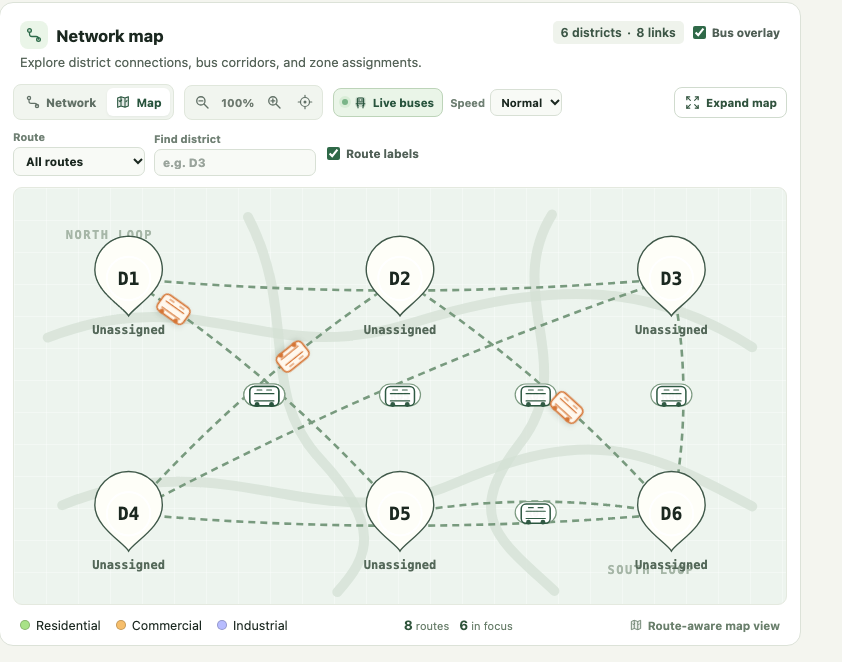
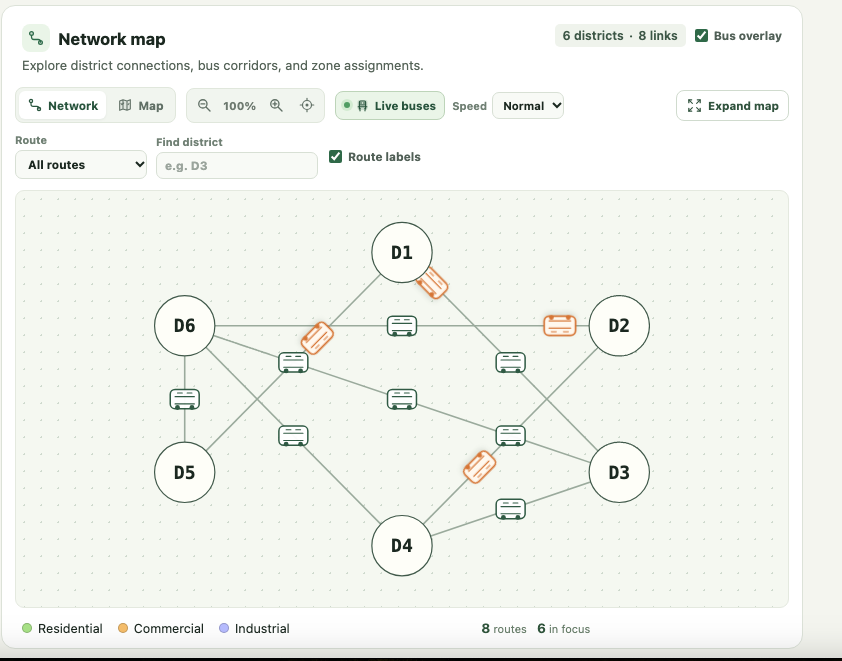
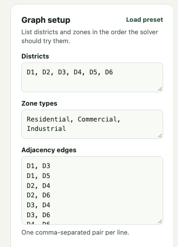
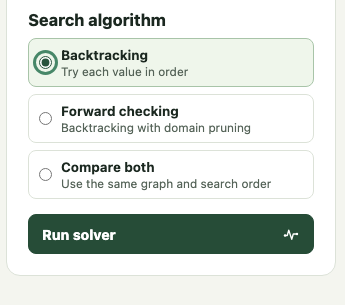

# CSP Zoning Solver

An interactive transit-planning dashboard for solving district zoning problems with constraint satisfaction. Define districts, zone types, and adjacency links, then compare plain backtracking with forward checking while the route map visualizes assignments, bus corridors, search steps, and network readiness.


## What you can do

- Build a district graph from comma-separated district, zone, and edge inputs.
- Compare backtracking and forward-checking search strategies.
- Inspect assignments, backtracks, conflicts, and the full search trace.
- Switch between a relationship graph and an expanded route-aware map.
- Watch simulated buses move along configured links, pause the simulation, and change speed.
- Filter routes, search and focus districts, toggle route labels, and zoom the map.
- Export the current graph and solver results as a JSON report.
- Use the FastAPI health endpoint and interactive API documentation.

## Screenshots

### Route map



### Network graph



### Graph setup



### Search algorithm controls



The moving buses in the interface are simulated from the configured graph edges. They are not connected to live GPS or public transit data.

## Quick start

### Requirements

- Python 3.11 or newer
- Node.js 20.19+, 22.12+, or another supported newer release
- npm

### 1. Start the FastAPI backend

From the project root, open a terminal and run:

```sh
cd backend
python3 -m venv .venv
source .venv/bin/activate
python -m pip install -r requirements.txt
python -m uvicorn app.main:app --reload --port 8000
```

On Windows PowerShell:

```powershell
cd backend
py -3 -m venv .venv
.venv\Scripts\Activate.ps1
python -m pip install -r requirements.txt
python -m uvicorn app.main:app --reload --port 8000
```

The API should be available at <http://localhost:8000>. If file watching is not supported by your environment, omit `--reload`.

### 2. Start the React frontend

Open a second terminal from the project root:

```sh
cd frontend
npm ci
npm run dev
```

Open <http://localhost:5173> in your browser. The frontend uses `http://localhost:8000` by default. To use another API URL, create `frontend/.env.local`:

```dotenv
VITE_API_URL=http://localhost:8000
```

### 3. Run the solver

1. Keep the preset or enter your own district and zone names. Separate names with commas or new lines.
2. Add one adjacency edge per line, for example `D1, D2`.
3. Choose **Backtracking**, **Forward checking**, or **Compare both**.
4. Select **Run solver**.
5. Review the results, assignments, moving buses, route filters, and search trace.

## API guide

### Health check

```sh
curl http://localhost:8000/api/health
```

Expected response:

```json
{"status":"ok"}
```

### Solve a graph

```sh
curl -X POST http://localhost:8000/api/solve \
  -H 'Content-Type: application/json' \
  -d '{
    "districts": ["A", "B"],
    "zone_types": ["Red", "Blue"],
    "edges": [["A", "B"]],
    "algorithm": "backtracking",
    "variable_order": ["A", "B"],
    "value_order": ["Red", "Blue"]
  }'
```

Supported algorithms are `backtracking` and `backtracking_with_propagation`. Invalid requests return HTTP 422. A valid unsatisfiable graph returns HTTP 200 with `success: false` and an empty solution.

Interactive API docs are available at <http://localhost:8000/docs> while the backend is running.

## Project structure

```text
backend/
  app/
    main.py                    FastAPI app and CORS configuration
    models.py                  Request and response validation
    routers/solve.py           Health and solve endpoints
    solver/                    CSP engine and search algorithms
  tests/test_solver.py         Backend test suite

frontend/
  src/App.jsx                  Dashboard state and solver workflow
  src/components/GraphView.jsx Interactive graph and route map
  src/components/GraphInput.jsx Graph editor and preset
  src/components/ResultSummary.jsx Results and zone utilization
  src/components/TraceViewer.jsx Search trace replay
  src/styles.css               Responsive dashboard styling
```

## Verify the project

Backend tests:

```sh
cd backend
source .venv/bin/activate
python -m pytest -q
```

Frontend production build:

```sh
cd frontend
npm run build
```

## Troubleshooting

### “Could not reach the solver”

Confirm that the backend is running and that port 8000 responds:

```sh
curl http://localhost:8000/api/health
```

If the command fails, start Uvicorn from `backend/` using the project virtual environment.

### Port already in use

Stop the existing process or use a different backend port, then set the matching `VITE_API_URL` in `frontend/.env.local` before starting Vite.

### Browser shows an old interface

Stop and restart the Vite process, then perform a hard refresh in the browser. The development server normally reloads source changes automatically.

## Read more

- [Backend guide](backend/README.md)
- [Frontend guide](frontend/README.md)
- [FastAPI interactive docs](http://localhost:8000/docs) when running locally
- [MIT License](LICENSE)

## License

This project is licensed under the MIT License. See [LICENSE](LICENSE) for the full text.
